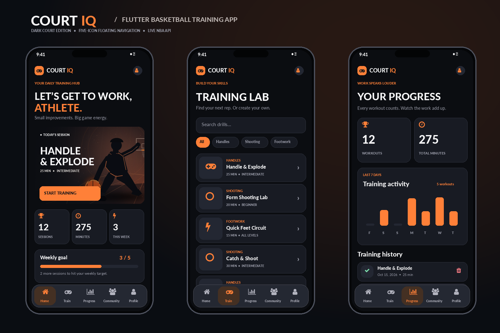

# COURT IQ — CC 302 Flutter Final Project

**Basketball training companion** with a dark orange-and-charcoal interface and a floating five-icon bottom ribbon. Built using Flutter and Dart.



*The preview illustrates the layout with example statistics; running totals are calculated from the actual saved data.*

## Problem, users, and purpose

Basketball players often practice without a consistent plan or record of completed workouts. Court IQ helps student players find drills, time sessions, save workout history, set a weekly goal, and access basketball headlines for inspiration. It works offline for training history and drill management; the NBA news section requires internet access.

## Set up and run (Windows / VS Code)

This ZIP contains the complete **application source code, local assets, tests, a code reviewer, and a Windows setup script**. It intentionally does **not** include a partial `android/` folder: Flutter creates the standard native Android/Gradle and Web files that match the Flutter SDK installed on your PC. The setup script then adds Android Internet permission automatically.

1. Install Flutter SDK, Android Studio/Android emulator (or connect an Android phone), and the VS Code Flutter extension.
2. Extract the ZIP to a simple path such as **`C:\FlutterProjects\CourtIQ`**. Avoid parentheses in paths such as `CC(dart)` because Windows build batch scripts may fail. Open the NEW **CourtIQ** folder in VS Code.
3. Open a **CMD** terminal in the folder and run `setup_windows.bat`. This generates the platform folders, configures the Android manifest and installs dependencies. Alternatively run:

   ```bash
   flutter create --project-name court_iq --platforms=android,web .
   powershell -NoProfile -ExecutionPolicy Bypass -File tools\configure_android.ps1
   flutter pub get
   flutter run -d emulator-5554
   ```

4. Start your Android Studio emulator first. `flutter devices` lists available devices; replace `emulator-5554` if yours has a different ID.
5. To run in Chrome instead, use `flutter run -d chrome` (requires Chrome and Flutter Web support).
6. To run on an iPhone, use **macOS with Xcode** and run `flutter create --platforms=ios .` followed by `flutter run` with the iPhone connected. An iPhone build cannot be compiled directly on Windows.

If Flutter reports an error while fetching packages, check the internet connection and re-run `flutter pub get`.

## Features and how to demonstrate them

| Tab | Working feature |
|---|---|
| **Home** | Personalized greeting, featured drill card, training totals, weekly goal progress, recommended drills. |
| **Train** | Search by drill name, filter by category, view drill instructions, start/pause/reset countdown, save a completed session. Add, edit and delete **custom drills** using form validation and confirmation. |
| **Progress** | Total workout count and minutes, 7-day chart, persistent list of completed sessions. Delete a session after confirming. Empty-state guidance. |
| **Community** | Fetch real basketball news headlines from the ESPN NBA JSON endpoint using `http` and `jsonDecode`; refresh, tap articles to see summaries, loading, error and empty states. On API failure, show clearly marked offline demonstration tips. |
| **Profile** | Change athlete name, set weekly session goal (1–7), view totals, clear local training data with confirmation, see data-source information. |

All user-created drills, logged workouts, athlete name and weekly goal persist locally across app restarts via `shared_preferences`. There are **eight built-in practice drills** which are intentionally not deletable; users can delete their own custom drills instead. Completed sessions are saved only when the user taps **Complete & Save Workout**.

### API source

- GET `https://site.api.espn.com/apis/site/v2/sports/basketball/nba/news?limit=12`
- `lib/services/nba_service.dart` performs a real `http.Client.get`, checks the HTTP status, decodes JSON, maps articles to `NewsStory`, and times out after 12 seconds.
- `lib/screens/community_screen.dart` shows a spinner while loading, list items for success, guidance for an empty feed, and a retry action if the API fails. Offline **training tips** are separately and explicitly labeled; they are not presented as live NBA articles.
- This is an openly accessible but **unofficial/third-party endpoint**, and availability is not guaranteed. Prepare to connect your phone/emulator to the internet for the actual API demonstration.

## CC 302 requirements checklist

| Requirement | Implementation |
|---|---|
| AppBar, titles | `lib/main.dart`, `lib/screens/workout_screen.dart` |
| Text/colors | `lib/theme/app_theme.dart` |
| Fonts/assets/icons | System font; basketball artwork in `assets/images/hero_training.png`; Material icons |
| Stateless/Stateful | Screens and reusable widgets throughout `lib/` |
| Custom reusable widgets | `lib/widgets/ui.dart`, `lib/widgets/floating_nav.dart` |
| ListView.builder | Training drill list, progress history, Community news feed |
| Real API integration | `lib/services/nba_service.dart` |
| Delete | Sessions in Progress; custom drills in Train; confirmation dialogs |
| Navigation | Five-tab floating ribbon; `Navigator.push` to training/detail pages |
| State management | `AppStore extends ChangeNotifier`, plus screen `setState` |
| Loading/error/empty | Community refresh/error UI, empty progress state and search state |
| Additional features | Custom drill CRUD, validation, timer, goals, search, filter, persistent data |
| HCI | Consistent theme, bottom labels, large touch targets, feedback, validation, deletion confirmation, scrolling |

## Suggested 3-minute class demo

1. Introduce Court IQ and describe the problem it solves for student basketball players.
2. Show the **floating five-tab ribbon**. Start **Home → Start Training**, describe the plan and timer, tap **Complete & Save Workout**.
3. Open **Progress** and show how totals and the graph change. Delete the new session, confirm, and show the totals update.
4. Open **Train**, add a custom drill, edit its duration, then delete it with confirmation. Search or filter drills.
5. Open **Community**, tap refresh to demonstrate the live NBA API and show the fetched headlines. Explain the timeout/retry and separately labeled offline tips.
6. Open **Profile**, change your name and weekly goal. Return Home to show the changes, then restart the app to show persistence.

## Tests

```bash
flutter analyze
flutter test
```

Tests cover persistence, create/edit/delete custom drills, goal/name persistence, corruption isolation, the five-tab UI and mocked NBA service success/failure/invalid JSON. Run these commands on your computer before submitting; this generated project has **not** been compiled in this workspace because the Flutter SDK is not installed here.

## Project tree

```text
CourtIQ/
├── assets/images/hero_training.png
├── lib/
│   ├── main.dart
│   ├── models/training.dart
│   ├── services/app_store.dart
│   ├── services/nba_service.dart
│   ├── screens/home_screen.dart
│   ├── screens/train_screen.dart
│   ├── screens/workout_screen.dart
│   ├── screens/progress_screen.dart
│   ├── screens/community_screen.dart
│   ├── screens/profile_screen.dart
│   ├── theme/app_theme.dart
│   └── widgets/ui.dart, floating_nav.dart
├── test/app_store_test.dart
├── test/widget_test.dart
├── tools/configure_android.ps1
├── CODE_REVIEWER_CC302.md
├── DEBUG_REPORT.md
├── pubspec.yaml
├── docs/ui_preview.png
├── analysis_options.yaml
└── setup_windows.bat

# android/ and web/ are generated on your machine by setup_windows.bat
```

## Reference activities (read and adapted conceptually)

- [cc_routingActivity](https://github.com/halooord/cc_routingActivity) — page separation, `MaterialApp`, routing, `Navigator` and tab selection patterns.
- [cc_Activity](https://github.com/halooord/cc_Activity) — `http.get`, `jsonDecode`, `StatefulWidget` and `ListView.builder` API patterns.

This is a new project, not a push to either reference repository. Before class, create a **new repository**, push the generated source plus platform files, check the public repo link, and submit that link in CASTLY.
